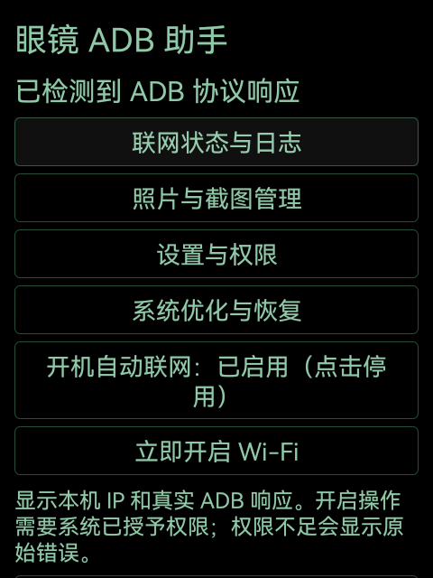
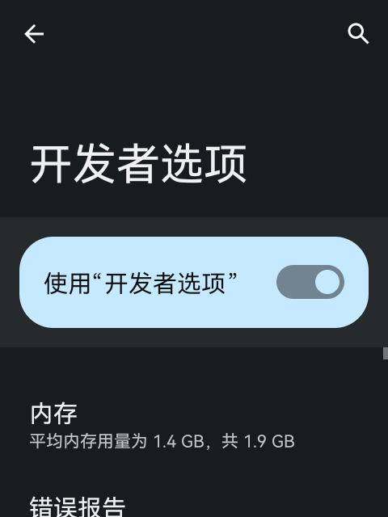
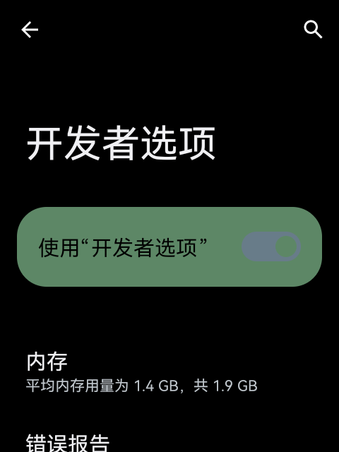

# Rokid Glasses Toolkit

让符合已验证配置的 Rokid RG-glasses 获得开机联网、本机管理、无线 ADB、工程版 root 和可恢复的系统优化。

当前版本：眼镜 ADB 助手 **1.7 / versionCode 8**。仓库提供助手源码、设备适配档案和复现流程，实机验证覆盖单台参考设备，多设备和跨地区适配尚未验证。厂家工程固件需单独获取，仓库不分发固件或厂商 APK。

## AI agent 使用入口

Codex 通过 [AGENTS.md](AGENTS.md) 读取项目约束，通过 [$rokid-glasses](.agents/skills/rokid-glasses/SKILL.md) 加载设备识别、联网、助手、OTA/root、优化恢复和发布任务所需的流程、工具与验收标准。其他 agent 可直接读取相同入口。

只读检查的调用示例：

```text
读取 AGENTS.md，使用 $rokid-glasses。
核验目标设备的硬件和固件，列出可复现能力及缺少的前提。
仅执行只读检查，不安装、不改设置、不刷机。
```

完整用法见 [AI agent 使用说明](docs/AGENT_USAGE.md)。读取技能不会自动获得设备操作授权，也不会把历史单台实测变成所有同款设备通用结论。

## 功能与验证状态

| 工作 | 实现方式 | 实机结果 |
| --- | --- | --- |
| 无线管理入口 | 显示 IP，识别真实 ADB `CNXN` / `AUTH` / `STLS` 响应，提供设置入口 | TCP ADB 5555 多轮重启和 `adb root` 后可重连；TLS 配对未完整验证 |
| 开机恢复 Wi-Fi | 开机广播、30/90 秒有限补查、已保存 SSID 匹配、后台定位授权 | 手机 App 退出前台后可自动恢复；手机关机或蓝牙关闭的独立性未验证 |
| 修复厂商后台启动限制 | targetSdk 25 配合本应用 `RUN_IN_BACKGROUND=allow` | 开机广播接收通过，无需修改系统 JAR |
| 网络诊断与照片管理 | 最近 40 条联网历史、网络校验状态、MediaStore 分页、预览、分享入口、确认删除 | 1.5 实测预览及删除取消/确认；1.7 仅复核空列表，手机端导出未验证 |
| 消费固件升级至工程版 | 原厂受信证书验签、原生 UpdateEngine、完整 A/B OTA | `1.27.009 user` → `1.28.001 userdebug`，安装成功，槽位切换及快照合并完成 |
| root | 工程版原生 `adb root`；助手通过现有本机 ADB 和系统 `su` 执行固定命令 | 实测 UID 0；重启后可重新 `adb root`；助手开机应用配置无需电脑先 root |
| 减少诊断日志 | 停止 `vendor.cnss_diag`，系统日志轮转份数 256 → 8 | 对照期间诊断进程消失，相关日志不再增长；系统 logcatd 保留 |
| 轻度待机 | 开启 Light Doze，保留助手和原厂连接服务豁免，Deep Doze 关闭 | 强制轻度待机时 Wi-Fi 与 ADB 可用，测试后退出强制模式 |
| 黑底显示与亮度预设 | 助手黑底绿字描边；六个 framework 颜色覆盖；20%/35% 预设 | 原生设置新进程黑底绿开关；亮度回读 50/89，恢复 136 |
| 恢复与持续应用 | 首次应用保存基线，独立开关、状态快照、恢复入口、开机有限重试 | 完整恢复及再次应用通过，首次基线跨重启保持 |

root 来源是厂家签名的工程版。没有获取厂商私钥，没有安装 Magisk，也没有修改启动镜像、关闭 AVB 或手工刷写分区。OTA 安装本身会按签名清单更新系统分区。

## 支持边界

参考设备配置：`RG-glasses / glasses / neo / Android 12 / API 32`，glass15 / RVE01 固件族，显示区域 480×640。测试前 bootloader 状态已为 unlocked/orange；验证流程未执行解锁，锁定设备安装同一固件的可行性尚未验证。

只有型号名相同不足以判断兼容。精确源指纹、目标指纹、签名证书和固件哈希见 [设备档案](profiles/rg-glasses-glass15-android12.json)。首次取得 ADB 的通用途径、不同地区 SKU、其他固件起点均未验证。

原工程版具有无需密钥认证的 TCP ADB，助手的系统控制依赖这一现状及 shell 可执行的系统 `su`。需要认证的固件会拒绝该控制通道，普通 APK 不会因此自动取得 root。工程版的 SELinux Permissive 也来自厂家构建。

## 从哪里开始

1. 阅读 [复现与验收](docs/REPRODUCE.md)，先确认有可用 ADB 和匹配硬件。
2. 运行只读检查，显式指定自己的连接目标。工具不自动扫描、连接或重启设备。

   ```sh
   python3 tools/rokid.py doctor --serial 'GLASSES_IP:5555'
   ```

3. 消费固件可先安装助手，使用联网、诊断、照片和设置功能。见 [助手安装与构建](docs/HELPER.md)。
4. 工程版与 root 路线见 [无线 OTA 记录及复现](docs/OTA.md)，先离线校验和设备原生适用性核验，再决定安装。
5. 已有相同工程版时，通过助手“系统优化与恢复”应用所需配置，并执行验收。

以上 `GLASSES_IP` 是占位符。主机工具只使用 Python 标准库；可选整包签名验证调用 OpenSSL。设备检查依赖本机已安装的 Android platform-tools。

## 项目结构

```text
AGENTS.md        面向所有 agent 的项目交接入口
.agents/skills/  Codex 技能、任务路由、排障知识和上下文定位脚本
app/             助手 1.7 Java 源码、Manifest、可移植构建脚本
tools/           只读设备检查、固定固件离线核验、公开文件检查
profiles/        精确设备字段、固件、证书、APK 校验值
releases/        通过实机验证的助手 1.7 APK 与 SHA256SUMS
evidence/        从私有原始记录提取的脱敏结果与证据哈希
docs/            原因、实现、复现、恢复、兼容性和发布事项
tests/           主机工具的离线测试
```



| 设置原配色 | 应用覆盖后新启动的设置 |
| --- | --- |
|  |  |

## 验证范围与后续

参考设备实机验证日期为 2026-10-21，详见 [实现与验证记录](docs/WORKLOG.md) 和 [脱敏证据](evidence/validated-results.json)。主机工具的离线测试与设备安装测试分别记录，离线测试通过不能替代实机验收。

尚未量化续航提升；没有完整回归手机语音/蓝牙工作流；没有实现新的 AI 助手、字幕/提词应用或自动媒体归档。保留原厂应用和服务不等于这些流程已全部通过交互测试。

发布前需确定源码许可证、仓库归属和工程固件的可持续获取方式，见 [发布清单](docs/RELEASE.md)。当前未附源码许可证，不应据此假定已获得开源授权。厂商固件和 APK 的权利另行处理。
